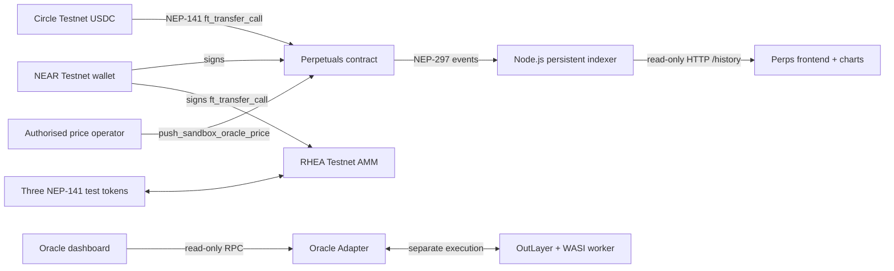

# ROASTAKE — Coffee Commodity Finance on NEAR

**ROASTAKE is a coffee-finance prototype built on NEAR Protocol.** It connects a Testnet perpetuals engine and token swap with a longer-term vision for coffee supply-chain finance. The `hackathon-submission` branch is the current hackathon implementation and authoritative source for this release.

> **Evaluation scope:** NEAR Testnet only. Test USDC, coffee reference tokens and synthetic oracle prices have no monetary value. Perps uses operator-published reference prices, not live exchange prices. Physical coffee custody and commercial redemption are not verified.

## 1. Problem and solution

Coffee producers, cooperatives, roasters and buyers face fragmented price discovery, risk management and trade settlement. Traditional commodity derivatives can be operationally inaccessible to smaller coffee participants, while supply-chain records are often disconnected from financial tools.

ROASTAKE explores a modular financial layer for the coffee economy. The first executable product is **fractional, isolated-margin coffee perpetuals on NEAR Testnet**. The wider vision includes coffee tokens, traceability, procurement and physical redemption, but those flows remain demonstrations until inventory, custody, legal and commercial integrations are independently verified.

## 2. What is live, simulated and planned

### Live NEAR Testnet integrations

| Module | What is implemented | Important boundary |
| --- | --- | --- |
| **Coffee Perpetuals** | Three registered markets; wallet-connected margin deposits, positions, closes, withdrawals, LP accounting and solvency views | Operator-controlled `TESTNET_SANDBOX_FEED` prices: Arabica $10/kg, Robusta $5/kg, Gesha $25/kg. Synthetic references, not commercial quotations |
| **Circle Testnet USDC** | NEP-141 collateral used by Perpetuals | Non-monetary Testnet tokens only |
| **RHEA Mini Swap** | NEP-141 coffee test tokens and RHEA/Ref Finance pools; frontend reads quotes and submits signed `ft_transfer_call` swaps | Demonstration token inventory and synthetic reference prices; not physical coffee |
| **Oracle Adapter / OutLayer** | Separate adapter and WASI worker; adapter stores observations from OutLayer execution | Separate workstream. Historical monthly IMF benchmark and Gesha fixture do **not** feed Perps execution |
| **Market History Indexer** | Node.js read-only service indexing finalized Testnet events for all three markets | Source included; public persistent hosting must be configured separately |

### Browser-only coffee experience

Seeded sample data and browser storage power the Marketplace, sample cart/checkout, roaster profiles, Coffee Passport, Roast Lab, Redeem, demo portfolio, balances, orders, yields and activity. These flows do not create commercial orders, payments, shipments or verified coffee custody.

The three NEP-141 coffee test tokens explicitly report `SIMULATED_TESTNET_INVENTORY`; physical redemption is disabled in their contracts.

### Roadmap

Verified supplier and warehouse integrations, attested physical reserves, commercial coffee price sources, live multi-source Perps oracle data, real marketplace orders/payments/shipments, physical redemption and production governance remain future work. There is no Mainnet deployment or independent third-party security audit claim.

## 3. NEAR Testnet contract registry

| Component | Testnet account / contract | Role |
| --- | --- | --- |
| Perpetuals | [`perps-v1.roastake-dev-mta.testnet`](https://explorer.testnet.near.org/accounts/perps-v1.roastake-dev-mta.testnet) | Trading, margin, positions and LP vault |
| Oracle Adapter | [`roastake-oracle-v1.testnet`](https://explorer.testnet.near.org/accounts/roastake-oracle-v1.testnet) | OutLayer request/callback and observation registry |
| OutLayer coordinator | [`outlayer.testnet`](https://explorer.testnet.near.org/accounts/outlayer.testnet) | Off-chain WASI execution service |
| Arabica token | [`arabica.roastake-dev-mta.testnet`](https://explorer.testnet.near.org/accounts/arabica.roastake-dev-mta.testnet) | NEP-141 coffee test token |
| Robusta token | [`robusta.roastake-dev-mta.testnet`](https://explorer.testnet.near.org/accounts/robusta.roastake-dev-mta.testnet) | NEP-141 coffee test token |
| Gesha token | [`gesha.roastake-dev-mta.testnet`](https://explorer.testnet.near.org/accounts/gesha.roastake-dev-mta.testnet) | NEP-141 coffee test token |
| RHEA / Ref Finance | [`ref-finance-101.testnet`](https://explorer.testnet.near.org/accounts/ref-finance-101.testnet) | Testnet AMM exchange and pools |
| Circle Testnet USDC | [`3e2210e1184b45b64c8a434c0a7e7b23cc04ea7eb7a6c3c32520d03d4afcb8af`](https://explorer.testnet.near.org/accounts/3e2210e1184b45b64c8a434c0a7e7b23cc04ea7eb7a6c3c32520d03d4afcb8af) | NEP-141 collateral token |

Transaction links below are historical reproducibility evidence, not a guarantee that a market feed is fresh when the Preview opens. New Perps positions require a sandbox tick less than 300 seconds old.

## 4. Transaction proof

These historical Testnet transactions demonstrate actual calls to the deployed Perpetuals contract. Test amounts have no monetary value.

| Market / action | Transaction |
| --- | --- |
| Arabica oracle tick | [Oracle tick #3](https://explorer.testnet.near.org/transactions/8KGqwWiHmFs2TQpDWWPEe8jRHWuBrfpjbe2EDBt47men) |
| Arabica LP deposit | [LP deposit](https://explorer.testnet.near.org/transactions/4b5cqULXF984ouYTUc5REX2vJbVKE3iYuTxAU1eZASd2) |
| Arabica LONG open | [Open position #2](https://explorer.testnet.near.org/transactions/CNgQkfrRpMrU8ywgzFaBdniPfivRDsgEnXcfoFX6gWAp) |
| Arabica close | [Close position #2](https://explorer.testnet.near.org/transactions/2QWybbu1rwxC9in5y8cxAzXzH7PR1bbH6x5WKDJHREnC) |
| Arabica withdrawal | [Withdraw collateral](https://explorer.testnet.near.org/transactions/DCAfqd5CSi2fk7ezsvo9J657yvX8M7NGEAqS6qvhZmFc) |
| Robusta market registration | [Register market](https://explorer.testnet.near.org/transactions/6yY3GdDY1fkTZcVXpizTv2r1eDsTLs8sHzsMV6rALaf6) |
| Robusta LONG open | [Open position #3](https://explorer.testnet.near.org/transactions/Dmd9uY1YmjVwR1mdBnzVQysjUjh8K6xNJi8mrHv9VJXw) |
| Robusta close | [Close position #3](https://explorer.testnet.near.org/transactions/ACKxYjULWt5AunYdLpJWmi9bCKgB69SmrDoCruBiHJnP) |
| Gesha market registration | [Register market](https://explorer.testnet.near.org/transactions/AAEy7eWTAyitTLpdg8Zew9F11a3wFd49zZDYXXFeWjjc) |
| Gesha LONG open | [Open position #4](https://explorer.testnet.near.org/transactions/A2cKFvi6YiL15EUjJXGejFbcuviEPmp8JRLCK5LmPwgh) |
| Gesha close | [Close position #4](https://explorer.testnet.near.org/transactions/JxF78YRwXUYwZwR6ZFo8QXXHxCv9sLD63yBTh3qNgKv) |
| OutLayer request | [Historical adapter request](https://explorer.testnet.near.org/transactions/58bW5j54R52UYZcXWUjHHQJjev368jj2ZNTKBpwZgCod) |
| OutLayer adapter deployment | [Adapter deployment](https://explorer.testnet.near.org/transactions/CBdkQcVR2Liocfx9sUTCpv9cHbcMmSmvDWCoZsB479P) |

Historical cycle accounting recorded `verify_solvency_invariant() = true`, zero open positions and zero in-flight withdrawals. Query current state independently before a live presentation.

## 5. Architecture



Perps execution and OutLayer are separate paths today. Perps consumes the operator-controlled Testnet sandbox feed. The adapter/worker is a separate historical benchmark integration.

## 6. Run and verify

```bash
cargo test --workspace
cd services/perps-indexer
node --test test/*.test.mjs
node src/indexer.mjs
```

For public indexer hosting, configure `HOST=0.0.0.0`, platform `PORT`, exact `CORS_ORIGIN` values and a persistent writable data disk. See [indexer deployment notes](services/perps-indexer/DEPLOYMENT.md). Set the public HTTPS service URL in the frontend build as `VITE_PERPS_HISTORY_API_URL`.

### Keep prices fresh for jury testing

The operator helper publishes the three synthetic references to registered Testnet markets. Before signing, it checks feed classification, configured operator, bounds, market mode and next sequence. It updates prices only; it does not unpause a market or change risk settings.

1. Copy `.env.example` to `.env` locally and set the authorised Testnet operator private key. Never commit `.env`.
2. Install the pinned signer dependency once with `npm install`.
3. Start the immediate refresh and 120-second loop with one command:

```bash
npm run keep-prices-fresh
```

Stop with Ctrl+C. Each refresh signs Testnet transactions. Keep the helper running only in a trusted operator environment. A fresh tick does not automatically clear an existing `ReduceOnly` or paused state.

### Frontend

Repository: [MTheMoneyApe/Roastake-frontend](https://github.com/MTheMoneyApe/Roastake-frontend)

- Current Preview branch: `feat/degen-mode-easter-egg`.
- Preview: https://roastake-git-feat-degen-mode-easter-egg-astrym.vercel.app/
- Production destination reserved for final release: https://roastake.vercel.app/
- The Preview is not the production deployment.

## 7. Risk boundaries

- All trading, collateral and tokens operate on NEAR Testnet and have no monetary value.
- Perps prices are synthetic operator-fed references, not live coffee quotations or decentralized oracle output.
- OutLayer is separate and does not power the live Perps feed.
- Coffee tokens report simulated Testnet inventory; no physical reserve/custody evidence is integrated and redemption is disabled.
- The indexer is read-only and requires persistent storage and one writer per data directory.
- No independent third-party smart-contract security audit or Mainnet release is claimed.
- Historical transactions do not prove current feed freshness or deployment state.

## 8. Licences

Apache-2.0 remains for previously distributed workspace and shared utilities. Newly authored Perps core/contract and indexer code is marked evaluation-only under `LICENSE-ROASTAKE-PERPS.md`. Review [LICENSES.md](LICENSES.md) and [THIRD_PARTY_NOTICES.md](THIRD_PARTY_NOTICES.md) before reuse.
