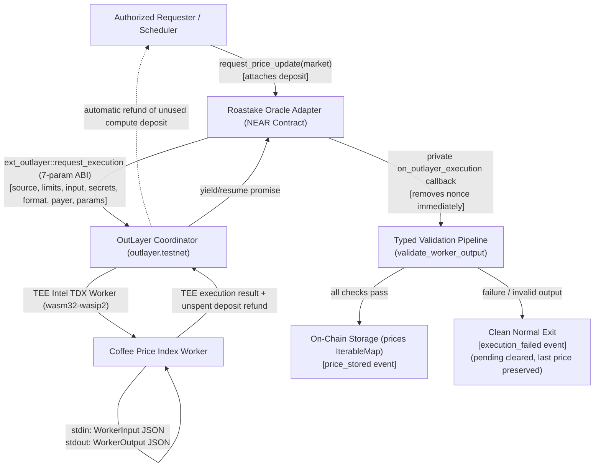

# Roastake Architecture

## Product Direction

Roastake is a coffee-focused commodity-finance platform. The first deliverable is Roastake Perps on NEAR Testnet; later modules may include Coffee Price Indices, Spot, Trade, and Treasury & Finance.

## Phase 1 System Boundaries

- `apps/web`: trading terminal and wallet connection.
- `contracts/oracle-adapter`: requests verifiable off-chain computation and stores validated index observations.
- `workers/coffee-price-index`: WASI program that accepts a JSON request on stdin and writes a JSON result to stdout.
- `contracts/perpetuals`: future position, collateral, margin, PnL, funding and liquidation logic. It must not be implemented until the oracle path is proven.
- `contracts/demo-token`: future test collateral only.
- `packages/shared`: shared schemas, OutLayer specs, and fixed-point utilities.

## Oracle Execution Lifecycle

1. **Request Trigger:** An authorized account calls `request_price_update(market)` attaching a deposit meeting the provisional threshold ($\ge \text{estimated\_cost}$).
2. **State Tracking:** The adapter allocates a monotonic nonce, registers the pending request, and designates the caller as `payer_account_id`.
3. **OutLayer Dispatch:** The adapter invokes `outlayer.testnet::request_execution` passing the 7 canonical parameters: `source` (`WasmUrl`), `resource_limits`, `input_data`, `secrets_ref: None`, `response_format: Some("Json")`, `payer_account_id: Some(caller)`, and `params: None`.
4. **TEE Computation:** OutLayer downloads the pinned WASM worker, executes it within an Intel TDX hardware enclave (`wasm32-wasip2`), and meters compute resource consumption.
5. **Dynamic Settlement:** OutLayer deducts actual execution fees and automatically refunds any unspent deposit directly to `payer_account_id`.
6. **Yield/Resume Callback:** OutLayer resolves the yield promise, delivering execution results directly to the adapter's chained private callback `on_outlayer_execution`.
7. **Fail-Closed State-Safe Validation:**
   - Callback removes pending request immediately (preventing replays).
   - If worker failed, OutLayer returns `b"null"`; callback logs `execution_failed` and returns `None`.
   - If NEAR cross-contract call failed (`PromiseError::Failed`), callback records an `UnreconciledFailure` (with zero immediate refund liability) because `PromiseError::Failed` can represent either an initial receipt failure or a downstream failure after OutLayer retained the deposit. Once backing is designated (`admin_designate_refund_reserve`) or explicitly funded (`fund_refund_reserve`), `promote_unreconciled_refund(nonce)` (which rejects active external-resolution proposals unless cleared via `reject_unreconciled_external_resolution` / `admin_cancel_unreconciled_external_resolution`) creates a 1:1 backed `RefundCredit`. Requesters withdraw via failure-safe `claim_refund()` with explicit `flush_storage()` across all **7** cached collections (of **8** total persistent `near_sdk::store` collections, including the uncached `LookupSet` `authorized_requesters`) before every formal solvency check (`spendable >= minimum_operating_reserve + refund_reserve_balance + insurance_reserve_balance + insurance_return_pending + backed_refund_liability`), monotonic `claim_id` identity (`RefundClaim`), terminal claim deletion on success, `ReturnPending` reconciliation on failed transfer, decoupled `Disputed` claim liveness (`active_claim_id = None` when disputed), non-destructive administrative settlement/resolution proposals requiring claimant acknowledgement, and separate insurance accounting (`total_in_flight_insurance_liability`, `total_unresolved_insurance_liability`). Initial `init()` reserves `STATE_STORAGE_MARGIN_BYTES = 512`, `propose_admin` and `set_outlayer_contract` enforce `STATE_GROWTH_MARGIN_BYTES = 128`, and `WorkerOutput.source` is capped at `MAX_WORKER_SOURCE_BYTES = 128` UTF-8 bytes so new `PriceObservation` insertions fit comfortably inside `OPEN_REQUEST_STORAGE_BUDGET_BYTES = 512`. Because NEAR contracts cannot inspect historical receipt outcomes on-chain, unacknowledged `Disputed` claims keep `encumbered_backing_floor` raised (`M-01` accepted liveness limitation; mitigated operationally via `fund_refund_reserve()`).
   - If response exceeds the 1,024-byte direct yield limit (`PromiseError::TooLong`), callback logs `execution_failed` without mutating prices or leaving stuck requests.
   - Validates schema, market, unit, decimals, bounds, divergence ($\le 20\%$), and timestamp freshness/monotonicity via pure `validate_worker_output()`.
   - On any validation failure, emits structured `execution_failed` event and terminates normally with `None` (removal committed, no stuck state, previous price preserved).
   - On success, persists the new observation in `prices` map and emits `price_stored` event.
8. **Downstream Consumption:** Future Perps engine reads only fresh, validated observations.

## Component Flow

## Trust Boundaries

TEE attestation establishes the integrity of the specified WASM, its input and output, and the worker identity. It does not prove that an external quotation is accurate, independent, licensed, or representative. Those properties belong to source selection and index methodology.

## Testnet Boundary

The initial release must reject mainnet configuration. All prices, balances, collateral and trades are demonstrations with no monetary value. Never use real funds or production market claims.

## Implementation Gates

- **Gate 1: Verify OutLayer Testnet request and callback contract interface.**
  - *Status:* PASSED (Mission 03C.3.7.6 Final Solvency Liveness, Fixture Accounting, Storage Safety & Documentation Consolidation Verified). Implemented in `contracts/oracle-adapter` with canonical 7-parameter `request_execution` ABI, verified against `outlayer.testnet` RPC schema and local `nearcore 2.14.0` (protocol 88) Sandbox. `88` adapter unit tests (`103` workspace Rust tests total across `88` adapter, `5` worker, and `10` shared tests) and `23` distinct NEAR Sandbox leaf tests (`21` release-candidate leaf tests + `1` blank smoke test + `1` legacy M03C.3.2 compatibility test; `25` entries reported by Node's runner including `2` outer suite wrappers) pass against `roastake_oracle_adapter_release_candidate_m03376.wasm` (`a9a07710ed10133b36b503fe81185cd83a8bbc2179a3f17ce8f09cc94c3756b8`, `378,335` bytes). Note: local NEAR Sandbox suites test against `Mock OutLayer` and do not prove live `outlayer.testnet` end-to-end execution.
- **Gate 2: Build a minimal deterministic WASI worker and publish its SHA-256-pinned artifact.**
  - *Status:* PASSED (Mission 01). Implemented in `workers/coffee-price-index` (`wasm32-wasip2`). SHA-256: `abac707a27b4633857a9c2703a2cae67e18d5369e7d41daed946ad8945ffe2a6`.
- **Gate 3: Complete one real Testnet request/callback and inspect its transaction and attestation.**
  - *Status:* READY FOR DEPLOYMENT REVIEW. Prepared for execution pending user approval to spend Testnet NEAR and sign transactions.
- **Gate 4: Add external coffee data retrieval with source and freshness checks.**
  - *Status:* FUTURE MILESTONE. Extension points (`IcoProvider`, `IceProvider`, `VerifiedSupplierProvider`) defined in code with fail-closed security.
- **Gate 5: Implement the Perps engine only after Gates 1-4 pass.**
  - *Status:* PLANNED. Blocked until live oracle data path is verified on Testnet.
