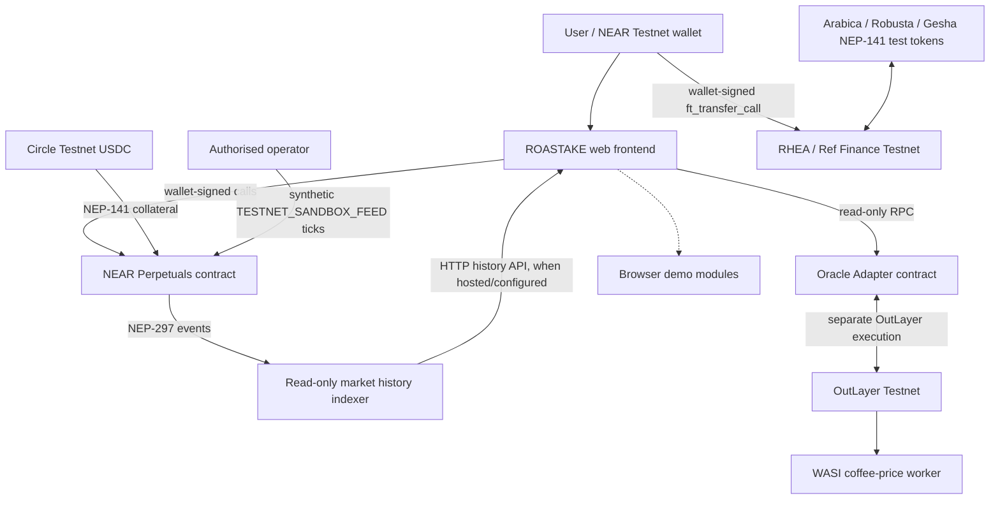

# ROASTAKE — Product & Technical Architecture

**Positioning:** Coffee Commodity Finance on NEAR.

ROASTAKE is a modular coffee-finance prototype. Its first executable on-chain product is a three-market coffee perpetuals engine on NEAR Testnet. The wider web experience explores adjacent workflows for coffee assets, lots, traceability, swaps and lifecycle operations. Those adjacent modules must be understood according to their implementation status below; the interface is not evidence of physical inventory, custody or commercial settlement.

## Submission entry points

- **Live product:** https://roastake.vercel.app
- **Protocol, contracts and backend:** https://github.com/MTheMoneyApe/Roastake/tree/hackathon-submission
- **Web frontend:** https://github.com/MTheMoneyApe/Roastake-frontend/tree/hackathon-submission

The two repositories are companion parts of one submission. The protocol repository is the primary technical submission; the frontend repository contains the web application presented in the live demo.

## System map

**Important separation:** the Perps engine consumes operator-published synthetic Testnet prices. The OutLayer adapter/worker is a separate oracle workstream and does not currently supply execution prices to Perps. The market-history indexer is read-only; it observes finalized contract events and does not execute trades.

## Module-to-implementation map

| Product surface | Implementation location | Current status / boundary |
| --- | --- | --- |
| Arabica, Robusta and Gesha Perpetuals | `contracts/` Perps workspace; frontend `src/lib/perps/` and `src/components/perps/` | NEAR Testnet contracts and wallet-signed flows. Prices are operator-controlled synthetic references, not live coffee quotations. |
| Positions, margin and LP accounting | Perps contract and frontend Perps client | On-chain Testnet functionality. Test collateral has no monetary value. |
| Market charts and history | `services/perps-indexer/`; frontend market-history API and chart components | Read-only event indexer. Public persistent hosting is a separate operational requirement; UI fallbacks are explicitly labelled. |
| RHEA mini swap | NEP-141 test tokens and RHEA / Ref Finance Testnet pools; frontend swap flow | Signed Testnet token swaps. Demonstration tokens and shallow Testnet liquidity; not a commercial coffee purchase. |
| Oracle monitor | `contracts/oracle-adapter/`, `workers/coffee-price-index/`; frontend Oracle view | Separate OutLayer integration. IMF monthly benchmark is historical; Gesha fixture is synthetic. Neither powers Perps execution. |
| Assets, Coffee Passport, lots | Frontend `src/lib/demo/` and coffee UI modules | Browser-seeded/sample experience. Not proof of tokenized physical inventory or verified custody. |
| Roast and Redeem | Frontend coffee workflow modules; test-token contracts explicitly disable physical redemption | Demonstration flows only. No verified warehouse, custody, shipment, payment or physical redemption integration. |
| Wallet, Activity, Multichain | Frontend wallet and activity modules | NEAR Testnet is the transaction network. Secondary EVM/Solana connections are identity-only, not bridge or cross-chain settlement. |

## Repository responsibilities

### Protocol & backend — `MTheMoneyApe/Roastake`

Contains the NEAR Rust workspace, Perps and Oracle contracts, shared packages, WASI worker, market-history indexer, operational scripts, integration tests and Testnet deployment/evidence documentation.

Start here to inspect the on-chain implementation, contract registry, transaction evidence and backend verification commands.

### Web frontend — `MTheMoneyApe/Roastake-frontend`

Contains the TanStack Start / Vite application, wallet integration, Perps terminals, charts and history client, Oracle monitor, swap interface, demo coffee modules, UI assets and frontend tests.

The public hackathon branch is `hackathon-submission`. The live demo is served at https://roastake.vercel.app.

## Evaluation boundaries

- NEAR Testnet only. Test USDC and coffee test tokens have no monetary value.
- Perps market prices are synthetic, operator-controlled references; they are not live spot or futures prices.
- OutLayer is not connected to Perps price execution.
- Coffee asset, Passport, Roast and Redeem experiences include browser-seeded or simulated data. No physical coffee custody or commercial redemption is verified.
- RHEA swaps use Testnet tokens and pools; execution is not a purchase of physical coffee.
- The indexer is read-only and needs persistent public hosting to provide a continuously available history API.
- No Mainnet release or independent third-party smart-contract audit is claimed.

## Suggested evaluation path

1. Open the [live ROASTAKE application](https://roastake.vercel.app).
2. Visit Perpetuals and inspect Arabica, Robusta and Gesha.
3. Inspect the [protocol README](../README.md) for contract accounts, Testnet transaction evidence and verification commands.
4. Review the [frontend source](https://github.com/MTheMoneyApe/Roastake-frontend/tree/hackathon-submission) for the user experience and wallet integration.
5. Use the status boundaries above when interpreting the Oracle, Swap and browser demo modules.
