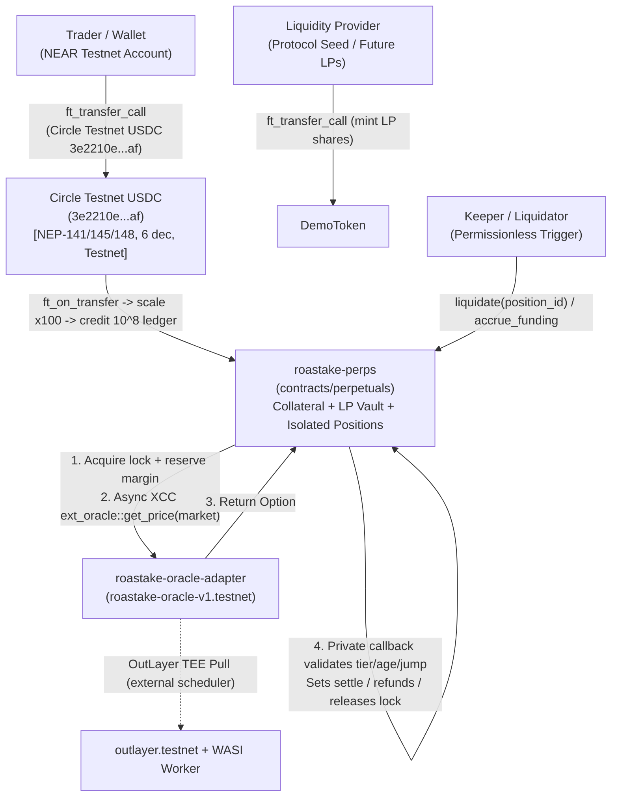

<!-- SPDX-License-Identifier: LicenseRef-ROASTAKE-Evaluation-Only -->
<!-- Copyright © 2026 @MTheMoneyApe. All rights reserved. -->

> **License:** [ROASTAKE EVALUATION-ONLY PROPRIETARY LICENSE v1.0](../../LICENSE-ROASTAKE-PERPS.md) — Copyright © 2026 @MTheMoneyApe. All rights reserved. **Licensor:** @MTheMoneyApe

# ROASTAKE Perpetuals — System Architecture Specification (M04.5B.1)

- **Status:** Pre-Deployment Validated for Circle NEAR Testnet USDC (`contracts/perpetuals`, Compiled Only — Not Yet Deployed)
- **Date:** 2026-11-11
- **Version:** `1.3.0-m045b1`
- **Target Network:** NEAR Testnet Only (`.near` Mainnet accounts and Mainnet Circle USDC `17208628...36133a1` strictly forbidden)
- **Dependencies:** `contracts/oracle-adapter` (`roastake-oracle-v1.testnet`, read-only), `packages/shared/src/perps.rs`, default external Circle NEAR Testnet USDC (`3e2210e1184b45b64c8a434c0a7e7b23cc04ea7eb7a6c3c32520d03d4afcb8af`, `NEP-141/145/148`, `decimals = 6` scaled `x100 -> USD_SCALE = 10^8`), `contracts/perpetuals` (`usdc.tidepool-sandbox.testnet` kept only as alternative integration fixture; `contracts/demo-token` / `rUSD` deferred to future roadmap)

---

## 1. Executive Decision: Peer-to-Pool Vault Oracle-Indexed

After evaluating four perpetuals designs against NEAR Protocol's sharded asynchronous runtime, storage/gas economics, and Testnet specialty coffee liquidity realities, M04.5A **validates and formalizes Peer-to-Pool Vault Oracle-Indexed (Isolated Margin)** as the sole viable MVP architecture.

### 1.1 Comparative Economic Analysis

| Architecture | Price Discovery Mechanism | Gas & Async Profile on NEAR | Capital Efficiency & Depth | Key Economic Failure Modes for Coffee Index | M04.5A Verdict |
| --- | --- | --- | --- | --- | --- |
| **Virtual AMM (vAMM)** | Constant-product $x \cdot y = k$ curve disconnected from external spot | Single-contract curve swaps possible, but requires periodic k-rebalancing & arbitrage bots | Poor on low-volume commodities without external arb bots | Curve permanently diverges from real coffee index; stale internal pricing creates path-dependent LP/vault insolvency | **Rejected** |
| **Hybrid CLOB (Order Book)** | Two-sided resting limit orders matched on-chain or off-chain | Every order place/cancel/match consumes gas + storage staking on NEAR | Near-zero resting depth on niche commodity pairs without dedicated MMs | Wide synthetic spreads, empty book halts, and wash-trading incentives on Testnet | **Rejected** |
| **Signed RFQ** | Off-chain market makers sign time-bound quotes verified on-chain | Requires off-chain quote relay infrastructure + Ed25519 signature verification | Good only if external MM desks stay online 24/7 | Centralized quote censorship, last-look free options, zero self-contained execution if MM goes dark | **Rejected** |
| **Peer-to-Pool Oracle-Indexed** | External verifiable Oracle index (`USD/kg`) + deterministic execution spread | Clean 2-step NEAR async pattern: user lock + XCC `get_price` + private settle callback | Instant depth bounded cleanly by LP Vault Equity & utilization caps (`75%`) | **Net directional skew exposure on LP Vault & gap insolvency on leveraged liquidations** — explicitly mitigated via caps, skew funding, insurance, and isolated reserves | **Selected (MVP)** |

---

## 2. System Topology & Data Flow

---

## 3. Protocol Participants & Responsibilities

| Participant | Economic Role | Capital / Collateral Posted | Risk Borne | Rewards / Compensation |
| --- | --- | --- | --- | --- |
| **Trader** | Opens leveraged (`<= 5x`) synthetic coffee positions | Isolated `Testnet USDC` margin (`>= 20%` IM, internal `USD_SCALE = 10^8`) + fees | Price risk up to `100%` of position locked margin + accrued funding & fees | Positive realized PnL + favorable skew funding |
| **Long** | Directional buyer (`entry` -> `mark`) | Isolated `Testnet USDC` collateral (`USD_SCALE = 10^8`) | Bears downside price decline + pays funding when `Long OI > Short OI` | Profits when `P_mark > P_entry` (net of fees/funding) |
| **Short** | Directional seller (`entry` -> `mark`) | Isolated `Testnet USDC` collateral (`USD_SCALE = 10^8`) | Bears upside price rally + pays funding when `Short OI > Long OI` | Profits when `P_mark < P_entry` (net of fees/funding) |
| **Liquidity Provider (LP)** | Supplies passive `Testnet USDC` backing into LP Vault | `Testnet USDC` (`x100` -> `USD_SCALE = 10^8`) exchanged for proportional LP NAV shares | **Counterparty to net skewed OI** + matched liquidation gap bad debt beyond Insurance Fund | Trade fee share (`70%`) + realized losing trader margins + net pool funding yield |
| **Insurance Fund** | Dedicated first-loss backstop buffer (`F_ins`) | Funded `Testnet USDC` + liquidation insurance fee share + `10%` fee split | Absorbs trader liquidation bad debt **before** LP Vault equity is impaired | Replenished continuously from fees and liquidation penalties |
| **Protocol Treasury** | Protocol operational / fee sink | Receives `20%` of trade fees (isolated bucket) | No passive balance-sheet liability unless protocol injects recapitalization | Treasury fee accumulation |
| **Admin (Multisig / Governance)** | Bounded risk configuration, pause/emergency controls | Operational governance gas (`NEAR`) | Never has permission to seize user `free_collateral` or manipulate live prices | None directly |
| **Keeper / Liquidator** | Monitors unhealthy positions & executes permissionless liquidations | Transaction gas (`NEAR`) | Front-run / reverted tx gas if position recovered before execution | Liquidator bonus (`50 bps` of mark notional) paid strictly from liquidated margin |

---

## 4. Counterparty Risk, Netting, and One-Sided Markets

### 4.1 The LP Vault Is Not a Passive Liquidity Box
A critical error in naive peer-to-pool specs is treating the LP Vault as simple passive inventory with no balance-sheet liabilities. Whenever traders hold profitable open positions or leveraged losing positions face price gaps, the LP Vault carries **real counterparty obligations**.

For any market (and aggregated across all markets sharing the LP Vault), define exact exposure terms (implemented cleanly in `packages/shared/src/perps.rs`):

- **Gross Long Open Interest ($OI_L$):** Sum of active long position notionals in `D8{USD}` (at entry or updated mark cap; contract tracks exact entry notional per open position so OI accounting conserves identically on close).
- **Gross Short Open Interest ($OI_S$):** Sum of active short position notionals in `D8{USD}`.
- **Net Trader Exposure ($\text{NetTrader}$):** Signed difference $OI_L - OI_S$. Positive implies traders are collectively net Long.
- **Pool Counterparty Exposure ($\text{NetPool}$):** Opposite sign of traders: $-(OI_L - OI_S) = OI_S - OI_L$.
- **LP Realized Equity ($E_{\text{LP,realized}}$):** Realized cash `USD_SCALE = 10^8` backing physically allocated to LP shareholders inside the contract.
- **LP MTM Equity ($E_{\text{LP,MTM}}$):** Computed via `compute_lp_mtm_equity_with_insurance_offset_e8`:
  $$E_{\text{LP,MTM}} = E_{\text{LP,realized}} + \min\Big(F_{\text{ins}},\; \sum_{p \in \text{Open}} \text{unrealized\_bad\_debt}_p\Big) - \sum_{p \in \text{Open}} \tilde{V}_p(P_{\text{mark}})$$
  where $\tilde{V}_p(P) = \max(-M_p,\; \text{capped\_PnL}_p(P) + \text{FundingNet}_p)$ bounds trader losses by isolated margin $M_p$, `max_pnl_bps = 10_000` caps single-position unrealized gains at `100%` of entry notional, and the insurance offset prevents temporary pre-liquidation NAV dilution without counting uncollected insurance as withdrawable cash.
- **Insurance Equity ($F_{\text{ins}}$):** Segregated first-loss reserve backing bad debt before $E_{\text{LP,realized}}$.
- **Reserved Liquidity ($R_{\text{LP}}$):** Conservative capital locked inside the LP Vault against active OI so LPs cannot withdraw funds needed to settle winners or cover gap risk:
  $$R_{\text{LP}} = |OI_L - OI_S| + \left\lceil \frac{2 \cdot \min(OI_L, OI_S) \cdot \text{matched\_gap\_buffer\_bps}}{10\,000} \right\rceil$$
  *Why matched OI still reserves a gap buffer (`2500 bps` = 25% provisional):* Even when $OI_L = OI_S = \$100\text{k}$ (zero net skew) at $5\times$ leverage ($M_L = \$20\text{k}, M_S = \$20\text{k}$), a sudden $+30\%$ gap rally pays Longs $+\$30\text{k}$ while defaulting Shorts only forfeit $\$20\text{k}$ margin — leaving a **$\$10\text{k}$ gap deficit** on the vault!
- **Available Liquidity ($A_{\text{LP}}$):** Strictly bounded withdrawable cash:
  $$A_{\text{LP}} = \max\Big(0,\; E_{\text{LP,realized}} - \max\big(R_{\text{LP}},\; \max(0, \Delta_{\text{MTM\_trader}})\big)\Big)$$

### 4.2 How Long & Short Offset vs. LP Absorption
1. **Matched Tranche ($\min(OI_L, OI_S)$):** Price gains on winning side equal price losses on opposing side dollar-for-dollar under normal liquidation execution. When both sides close peacefully above zero equity, losing margin flows into $E_{\text{LP,realized}}$ and winning PnL pays out of $E_{\text{LP,realized}}$, netting to zero pool change (plus fees!).
2. **Net Skew ($|OI_L - OI_S|$):** Unmatched open interest acts **1:1 as a directional trade against the LP Vault**. If Longs win on a Long-skewed book, net payouts reduce $E_{\text{LP,realized}}$ directly.
3. **Insolvent Shortfall Above Margin (`Bad Debt`):** Any individual position closing below `0` equity ($M_p + \text{PnL}_p + \text{Funding}_p < 0$) leaves a shortfall absorbed via the strict loss waterfall: Margin $\to$ Insurance Fund $\to$ LP Vault $\to$ Market Pause.

### 4.3 Behavior Under Extreme One-Sided Skew (All Long or All Short)
When $100\%$ of traders pile onto one side (e.g., $OI_S = 0$, $OI_L \to \text{cap}$):
1. **Utilization Hard Cap (`75%`) + `max_pnl_bps = 10_000`:** $R_{\text{LP}}$ grows 1:1 with $OI_L$. Once $\lceil R_{\text{LP}} / E_{\text{LP,MTM}} \rceil > U_{\max}$, new same-side `open_position` / `increase_position` calls fail closed (`ERR_MAX_UTILIZATION_EXCEEDED`), while `max_pnl_bps = 10_000` guarantees even a `> +100%` one-sided rally cannot break 1:1 Vault solvency. Closing positions and **opposite-side orders** (reducing $|OI_L - OI_S|$) remain permitted!
2. **Skew Funding Drain:** Because `OI_L > OI_S`, continuous funding `r > 0` flows from the crowded side **directly to the LP Vault** (upon position settlement / closing) + any contrarian shorts, economically paying LPs to warehouse directional skew and attracting counter-trades.
3. **Asymmetric Execution Spread / Impact:** Trade execution adds a deterministic skew fee/spread penalty on skew-increasing orders while offering tighter execution on skew-reducing closes.

---

## 5. Testnet Bootstrapping & Centralization Disclosure

### 5.1 Phase 1 Bootstrapping Policy (Testnet MVP — Not Yet Deployed)
- **Default Collateral Token:** Official Circle NEAR Testnet USDC (`3e2210e1184b45b64c8a434c0a7e7b23cc04ea7eb7a6c3c32520d03d4afcb8af`, Intents URI `nep141:3e2210e1184b45b64c8a434c0a7e7b23cc04ea7eb7a6c3c32520d03d4afcb8af`, `decimals = 6` scaled `x100 -> USD_SCALE = 10^8`). Unapproved tokens claiming `"USDC"` (including `usdc.tidepool-sandbox.testnet` unless explicitly added as an alternative fixture) are rejected fail-closed; `rUSD` remains deferred to post-hackathon roadmap.
- **Oracle Consumption:** Dual per-market mode in `contracts/perpetuals/src/oracle.rs`: (a) `ExternalXcc` async pull from `roastake-oracle-v1.testnet` (`PUBLIC_BENCHMARK_MONTHLY` & `SYNTHETIC_DEMO` blocked — and live RPC confirms `roastake-oracle-v1.testnet` currently serves only those two), or (b) isolated `TestnetSandboxOperator` (`TESTNET_SANDBOX_FEED`) inside `contracts/perpetuals`.
- **Initial Liquidity Source:** Protocol-operated / test accounts acquiring Circle Testnet USDC via `https://faucet.circle.com/` (`20 USDC` / `2h`, manual reCAPTCHA) and depositing via `ft_transfer_call` with `{"action":"lp_deposit"}`, locking `MINIMUM_LP_SEED_SHARES = 10_000` on first seed.
- **Why Gated First, Permissionless Later:** On Testnet with controlled `TESTNET_SANDBOX_FEED` or low-cadence feeds, open permissionless LP inflows before validating anti-frontrunning spreads and MTM share valuation expose external LPs to synthetic timing games. Permissionless LP onboarding opens only after M04.5G sandbox/testnet chaos testing confirms zero share-inflation or stale-oracle extraction paths.

### 5.2 Explicit Centralization, Collateral & Deployment Distinctions
1. **Admin Multisig Privileges:** Admin configures market caps, triggers `MarketMode::Paused`, manages `TESTNET_SANDBOX_FEED` authorizations, and sets emergency recovery settlement prices during prolonged outages. Admin **cannot** withdraw user `free_collateral`, forge balance changes, or seize healthy positions. Admin transfers require two-step `propose_admin` + `accept_admin`.
2. **Circle Testnet USDC Governance (`3e2210e...af`):** Validated live on NEAR Testnet RPC (`315,265` bytes, `37` exports including `ft_transfer_call` and `ft_resolve_transfer`, `0.00125 NEAR` storage bound). Carries Circle multisig governance roles (`admins`, `owners`, `master_minters`, `pausers`, `blocklister`) and zero real-world value. Any future Testnet account freeze/pause safely reverts `ft_transfer` to `on_withdraw_transfer` restoring ledger credit. (`usdc.tidepool-sandbox.testnet` is alternative fixture only; `mock-ft` is local NEAR Sandbox only; `rUSD` is unbuilt future roadmap.)
3. **Compiled vs. Deployed State:** `contracts/perpetuals` is compiled and locally verified in Sandbox (`4 passed; 0 failed`), **NOT yet deployed** to `perps-v1.roastake-dev-mta.testnet`. (`roastake-oracle-v1.testnet` IS already deployed live on Testnet and stays strictly read-only.)
3. **Keeper Liveness:** Liquidations and funding triggers are **permissionless** (any account may call), but rely in practice on an off-chain ROASTAKE Testnet keeper bot for rapid execution.
4. **Oracle Trust Assumption:** OutLayer TEE attestation validates deterministic WASM computation against pinned code hashes, NOT external commercial data provenance until multi-source commercial APIs (Gate 4) replace Testnet sandbox feeds.

---

## 6. Explicit Assumptions, Open Decisions & Pending Risks

- **Assumptions:** Single unified multi-market LP Vault settled at `USD_SCALE = 10^8` backed by allowlisted Circle NEAR Testnet USDC (`3e2210e1184b45b64c8a434c0a7e7b23cc04ea7eb7a6c3c32520d03d4afcb8af`, `NEP-141/145/148`, `decimals = 6`, `x100` scaling with lossless `<100 e8` residue retention); Isolated Margin only in Phase 1; dual Oracle configuration (`ExternalXcc` async pull from `roastake-oracle-v1.testnet` + isolated `TestnetSandboxOperator` `TESTNET_SANDBOX_FEED` inside `contracts/perpetuals`). (`usdc.tidepool-sandbox.testnet` is alternative integration fixture only; `rUSD` / `contracts/demo-token` remains deferred to future roadmap.)
- **Open Decisions:**
  1. Exact timing threshold for unlocking permissionless LP deposits post-M04.5G QA.
  2. Governance timelock duration for admin parameter changes vs instant `Paused` circuit breaker.
  3. Whether fee split (`70% LP / 10% Insurance / 20% Treasury`) remains fixed at MVP launch or parameterized per market.
- **Pending Risks:**
  1. Sudden >`12%` coffee gap exceeding IM (`20%`) before Keeper liquidation receipt settles on NEAR (~1-2s block latency + OutLayer feed lag).
  2. Coordinated skew exhaustion forcing prolonged `REDUCE_ONLY` states during volatile Testnet demonstrations.
