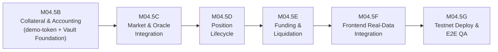

<!-- SPDX-License-Identifier: LicenseRef-ROASTAKE-Evaluation-Only -->
<!-- Copyright © 2026 @MTheMoneyApe. All rights reserved. -->

> **License:** [ROASTAKE EVALUATION-ONLY PROPRIETARY LICENSE v1.0](../../LICENSE-ROASTAKE-PERPS.md) — Copyright © 2026 @MTheMoneyApe. All rights reserved. **Licensor:** @MTheMoneyApe

# ROASTAKE Perpetuals — Phased Implementation Roadmap (M04.5B–M04.5G)

- **Status:** M04.5B + M04.5B.1 Pre-Deployment Validation Complete (`Circle Testnet USDC` migrated, Compiled Locally — Not Yet Deployed)
- **Date:** 2026-11-11
- **Version:** `1.3.0-m045b1`
- **Scope Note:** `contracts/demo-token` (`rUSD`) is **deferred** to post-hackathon roadmap; `usdc.tidepool-sandbox.testnet` is **alternative fixture only**; official **Circle NEAR Testnet USDC (`3e2210e1184b45b64c8a434c0a7e7b23cc04ea7eb7a6c3c32520d03d4afcb8af`)** is configured as default MVP collateral after live Testnet RPC + WASM validation. Live deployment waits for M04.5G / explicit user authorization.

---

## Overview Sequence

---

## M04.5B / M04.5B.1 (Consolidated Core MVP + Circle Pre-Deploy Validation) — Collateral, Markets, Positions, Funding & Liquidation (`READY FOR AUTHORIZED DEPLOY`)

- **Dependencies:** M04.5A & M04.5A.1 complete (`packages/shared/src/perps.rs`), on-chain validated **Circle NEAR Testnet USDC** (`3e2210e1184b45b64c8a434c0a7e7b23cc04ea7eb7a6c3c32520d03d4afcb8af`, `decimals = 6`), read-only `contracts/oracle-adapter` (`roastake-oracle-v1.testnet`).
- **Implemented Files:** `contracts/perpetuals/*`, `scripts/build-perpetuals.ps1`, `scripts/deploy-perpetuals-testnet.ps1`, `integration-tests/near-sandbox-js/mock-ft/*`, `integration-tests/near-sandbox-js/test/sandbox-perpetuals.test.mjs`, `docs/perpetuals/TESTNET_MVP_OPERATIONS.md`. (**`contracts/oracle-adapter`, `workers/`, `Roastake-Frontend`, and `contracts/demo-token` (`rUSD`) were NOT modified/created.**)
- **Delivered Scope:**
  1. **Collateral & Custody:** Allowlisted Circle NEAR Testnet USDC default (`decimals = 6` -> `x100` `USD_SCALE = 10^8`, lossless `<100 e8` sub-micro-USDC residues, Mainnet Circle USDC `17208628...36133a1` & unapproved Tidepool/rogue tokens rejected fail-closed), `ft_on_transfer`, `on_verify_collateral_metadata` handling `1,772`-byte SVG metadata, non-panicking `on_withdraw_transfer` restoration, LP seed share lock (`MINIMUM_LP_SEED_SHARES = 10_000`), strict `ContractCashBuckets` solvency (`sum(buckets) == tracked_collateral_e8`).
  2. **Dual Oracle Consumption:** `ExternalXcc` async 2-receipt `ext_oracle::get_price` pull (blocking `ARABICA-MONTHLY-IMF/USD`, `GESHA-DEMO/USD`, `PUBLIC_BENCHMARK_MONTHLY`, `SYNTHETIC_DEMO`) + isolated `TestnetSandboxOperator` (`TESTNET_SANDBOX_FEED`), freshness gates (`300s`), `500 bps` jump circuit-breaker (`ReduceOnly`), lock release on `PromiseError`, and transparent `MarketView` synthetic tags.
  3. **Position Lifecycle & Emergency:** `open_position`, `increase_position`, `reduce_position`, `close_position`, `add_margin`, `remove_margin`, `max_pnl_bps = 10_000`, `75%` utilization guard, MTM LP valuation with insurance offset, and **Uniform Global Emergency Settlement** (`trigger_emergency_settlement` + `claim_emergency_settlement` with `close_fee = 0` & LP exit lock until `open_positions == 0`).
  4. **Funding & Liquidation:** High-precision interval skew funding (`compute_funding_delta_over_interval_e12`), permissionless `liquidate_position`, Liquidation-Before-Winner ordering, and full bad-debt cascade (`Margin -> Insurance -> LP Vault -> Pause`).
- **Deferred Scope (`Future Roadmap`):** Dedicated `rUSD` (`contracts/demo-token`) if custom 8-decimal collateral becomes needed; live commercial commodity API feeds (Gate 4); live Testnet deployment (**dry-run only** in M04.5B / M04.5B.1).

---

## M04.5F — Frontend Real-Data Integration

- **Dependencies:** Authorized M04.5G deployment & finalized contract ABI.
- **Allowed Files (`Roastake-Frontend` repo):** Explicit M04.5F authorization only (`src/lib/perps/*`, `src/lib/wallet/*`, `src/components/trading.tsx`, `src/components/wallet/*`, `src/test/*`). **Strictly read-only until M04.5F is explicitly authorized!**
- **Scope:** Integrate frontend UI (`Roastake-Frontend`) with deployed NEAR Testnet `roastake-perps` & Circle NEAR Testnet USDC (`3e2210e1184b45b64c8a434c0a7e7b23cc04ea7eb7a6c3c32520d03d4afcb8af`) views + wallet-signed transactions via NEAR Wallet Hub (`M04.4`), displaying live contract positions, Circle Testnet faucet links (`https://faucet.circle.com/`), on-chain solvency snapshots, and real transaction history (`rUSD` deferred; Tidepool alternative only).
- **Key Risks:** Mixing simulated `localStorage` dollars with on-chain Testnet USDC balances; treating UI `indicative_liquidation_price` as binding guarantee; confusing Circle Testnet USDC (`no value`) with Mainnet USDC (`17208628...36133a1`).
- **Required Unit & UI Tests:** Strict separation of on-chain Testnet USDC vs Demo simulator; clear `TESTNET SANDBOX · NO MONETARY VALUE` badges; slippage parameter & NEAR Testnet chain guard (reject `.near` & Mainnet USDC); RPC error fail-closed UI states.
- **Acceptance Criteria:** Zero simulated balance bleed; users can read real contract positions/margin ratios and construct valid NEAR Testnet tx payloads; Vitest + Vite production build + browser QA pass cleanly.
- **Verifiable Evidence:** Frontend test report, CDP visual QA screenshots, real wallet transaction signature logs (Testnet only).
- **Blocking Conditions:** Unfinished Testnet deployment (M04.5G) or missing Testnet USDC / Oracle Sandbox feed separation.

---

## M04.5G — Testnet Deployment & End-to-End QA (Next Gate — Requires Explicit User Authorization)

- **Dependencies:** M04.5B.1 pre-deployment checks complete + explicit user authorization for live Testnet deploy & manual Circle faucet funding (`https://faucet.circle.com/`).
- **Allowed Files / Ops:** Build scripts (`scripts/build-perpetuals.ps1`, `scripts/deploy-perpetuals-testnet.ps1`), deployment docs, **user-approved explicit Testnet deployment** (`*.testnet` accounts + Circle Testnet USDC `3e2210e...af` ONLY).
- **Scope:** Deploy `roastake-perps` (`roastake_perpetuals.wasm`) to NEAR Testnet; complete `storage_deposit` (`0.00125 NEAR`) on `3e2210e1184b45b64c8a434c0a7e7b23cc04ea7eb7a6c3c32520d03d4afcb8af`; run `verify_collateral_metadata`; register Testnet market (`COFFEE-ARABICA-TESTNET/USD` using `TESTNET_SANDBOX_FEED` until Gate 4 live feeds exist on `roastake-oracle-v1.testnet`); fund via `https://faucet.circle.com/`; execute live E2E test matrix and verify NEP-297 explorer logs. (`rUSD` deferred.)
- **Key Risks:** Gas exhaustion under live NEAR shard congestion; real OutLayer latency exceeding `300s` sandbox freshness unless keeper frequency aligns; misconfigured admin keys.
- **Required Integration & Live QA Tests:** Verified NEAR Testnet explorer receipts for every operation; negative tests verifying `.near` rejection, failed withdrawal recovery, stale-oracle `ReduceOnly` transition, and `Emergency` close on Testnet.
- **Acceptance Criteria:** Full live E2E pass on NEAR Testnet with post-test `verify_solvency_invariant() == true`, preserved Testnet-only safety guarantees, and complete hackathon/audit evidence dossier.
- **Verifiable Evidence:** NEAR Testnet transaction hashes, contract account IDs, verified WASM SHA-256 hashes, `get_accounting_snapshot()` reconciliation log.
- **Blocking Conditions:** Explicit user authorization required before spending Testnet NEAR or deploying live contracts; any solvency discrepancy or failed callback leak blocks sign-off.
