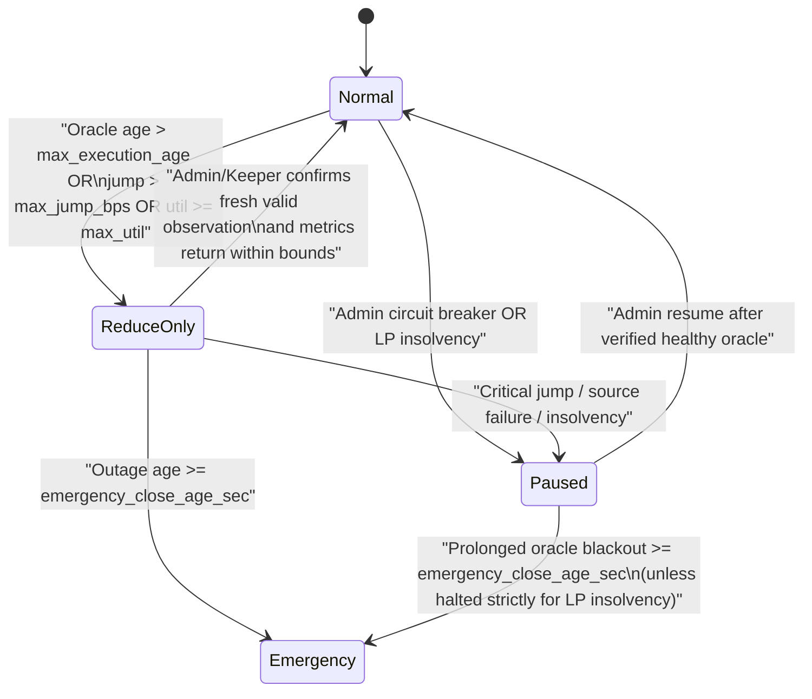

<!-- SPDX-License-Identifier: LicenseRef-ROASTAKE-Evaluation-Only -->
<!-- Copyright © 2026 @MTheMoneyApe. All rights reserved. -->

> **License:** [ROASTAKE EVALUATION-ONLY PROPRIETARY LICENSE v1.0](../../LICENSE-ROASTAKE-PERPS.md) — Copyright © 2026 @MTheMoneyApe. All rights reserved. **Licensor:** @MTheMoneyApe

# ROASTAKE Perpetuals — Oracle Consumption, Freshness & Outage Policy (M04.5B.1)

- **Status:** Verified & Pre-Deployment Validated (`contracts/perpetuals/src/oracle.rs` + `packages/shared/src/perps.rs`)
- **Date:** 2026-11-11
- **Version:** `1.3.0-m045b1`
- **Deployed Reference Contract:** `roastake-oracle-v1.testnet` (`contracts/oracle-adapter` — untouched & read-only)

---

## 1. Boundary Against Existing Deployed Markets (`roastake-oracle-v1.testnet` Live State)

Live RPC verification (`2026-11-11`, block `277154878–277154933`) confirms `roastake-oracle-v1.testnet` (deployed & healthy, `verify_solvency_invariant = true`, `admin = roastake-dev-mta.testnet`) serves ONLY two markets, neither authorized for Perpetuals execution:

| Existing Market | Live `data_class` & `observed_at` | `worker_mode` | Policy Window | Perpetuals Authorization |
| --- | --- | --- | --- | --- |
| `ARABICA-MONTHLY-IMF/USD` | `PUBLIC_BENCHMARK_MONTHLY` (`price: 738863238`, `observed_at_sec: 1793491199`) | `public_benchmark` | 90 days (`7,776,000 s`) | **STRICTLY FORBIDDEN** for execution & liquidation (`ERR_ORACLE_CLASS_REJECTED`) |
| `GESHA-DEMO/USD` | `SYNTHETIC_DEMO` (`price: null` currently on Testnet) | `fixture` | `observed_at = 0` | **STRICTLY FORBIDDEN** for Perpetuals execution & liquidation (`ERR_ORACLE_CLASS_REJECTED`) |

Because `LIVE_AGGREGATED` exists only in local WASM Sandbox tests (`sandbox-perpetuals.test.mjs`) and **is NOT present on public `roastake-oracle-v1.testnet` today**, Testnet MVP verification uses the isolated `TestnetSandboxOperator` (`TESTNET_SANDBOX_FEED`) inside `contracts/perpetuals` itself (leaving `contracts/oracle-adapter` and `workers/` untouched) with explicit operator auth, monotonic sequence numbers, `[min_price_e8, max_price_e8]` bounds, `300s` max execution staleness, fail-closed missing/stale checks, and visible `MarketView` synthetic tags (`is_synthetic_testnet_sandbox = true`, `feed_classification = "TESTNET_SANDBOX_FEED"`).

> **Hard Architectural Rule:** Neither `contracts/oracle-adapter` nor `workers/coffee-price-index` may ever be weakened or relabeled to make a synthetic fixture or historical monthly benchmark appear live (`ORACLE_POLICY` fails closed on `evaluate_oracle_for_perps`).

---

## 2. Formal Market Feed Classifications

Future Perpetuals markets connect strictly to explicit Oracle feed classes enforced via `OracleFeedTier` (`packages/shared/src/perps.rs`):

| Feed Tier | Required `data_class` & `worker_mode` | Eligible Environments | Requirements & Safeguards |
| --- | --- | --- | --- |
| **`ProductionLive`** | `LIVE_VERIFIED` (`>= 1` src) or `LIVE_AGGREGATED` (`>= 2` src) + `mode = live_index` | Future authorized markets (Gate 4+) | Commercial/licensed price provenance, `max_execution_age <= 300s`, multi-source spread check `<= 500 bps`, active keeper cadence, zero synthetic fallback |
| **`TestnetSandbox`** | `TESTNET_SANDBOX_FEED` + `mode = testnet_sandbox` | **NEAR Testnet ONLY** (`allow_testnet_sandbox = true`) | Strictly non-commercial simulated/external test feed for proving E2E PnL, funding, and liquidation trajectories; isolated market symbol (`*-TESTNET/USD`), UI explicitly badged **TESTNET SANDBOX FEED**, forbidden from production claims |
| **`HistoricalBenchmark`** | `PUBLIC_BENCHMARK_MONTHLY` + `mode = public_benchmark` | Informational telemetry | Monthly cadence only; `OracleClassRejected` if referenced by Perpetuals |
| **`SyntheticFixture`** | `SYNTHETIC_DEMO` + `mode = fixture` | Oracle smoke-test only | Static `$18.50/kg`, `observed_at = 0`; `OracleClassRejected` if referenced by Perpetuals |

---

## 3. Price Definitions & Threshold Parameters

| Price / Policy Term | Formal Definition | Testnet Parameter / Rule |
| --- | --- | --- |
| **Index Price ($P_{\text{index}}$)** | Last validated on-chain `PriceObservation.price` pulled via XCC `get_price` from allowed `OracleFeedTier` | Precision: `10^8` (`USD/kg`), monotonic `observed_at_sec` |
| **Mark Price ($P_{\text{mark}}$)** | Equal to $P_{\text{index}}$ in Phase 1 (after passing freshness & jump checks) | Zero unverified internal curve distortion |
| **Execution Price ($P_{\text{exec}}$)** | $P_{\text{mark}}$ adjusted symmetrically by deterministic `exec_spread_bps` against trade direction + bounded by user `slippage_guard` | Computed on-chain inside XCC callback; zero fake depth simulation |
| **Bid / Ask Spread** | Deterministic symmetric half-spread `exec_spread_bps` (when non-zero) applied on `open` / `increase` / `reduce` / `close` | Provisional: `0–5 bps` alongside `10 bps` taker fee |
| **TWAP** | Time-weighted average price smoothing | **Deferred past Phase 1 MVP** — Phase 1 enforces immediate `max_jump_bps` circuit breaker (`500 bps`) + execution spread instead of slow multi-block on-chain storage history |
| **Last Valid Price ($P_{\text{last}}$)** | Most recent observation that passed `ValidForExecution` recorded in Perps market state | Used solely as reference for `jump_bps` check and global **Uniform Emergency Settlement** snapshot (`frozen_settlement_price_e8`) — **NEVER silently used for normal trading or liquidations!** |
| **Max Execution Age** | Max `now_sec - observed_at_sec` for normal trading & liquidations | **Pending Data Source (`300 s` target live; `300–900 s` sandbox)** |
| **Emergency Close Age** | Age past last valid observation authorizing `MarketMode::Emergency` | **`3,600 s` (1 hour)** provisional Testnet window |
| **Max Price Jump** | $|P_{\text{obs}} - P_{\text{last}}| \cdot 10\,000 / P_{\text{last}}$ per observation transition | **`500 bps` (`5%`) circuit breaker** -> pauses / enters `ReduceOnly` instead of falling back to stale `P_last` |
| **Max Source Spread** | Dispersion threshold across multi-source inputs inside OutLayer TEE worker | **`500 bps` (`5%`)** (`roastake_shared::DEFAULT_MAX_SOURCE_SPREAD_BPS`) |
| **Max Clock Drift** | Maximum seconds `observed_at_sec` may exceed NEAR block time | **`60 s`** (`roastake_shared::DEFAULT_MAX_CLOCK_DRIFT_SEC`) |

---

## 4. Per-Operation Freshness Matrix (Section 7)

Every contract entry point explicitly obeys the following freshness table:

| Operation | Fresh Price Required? | Exact Behavior & Conditions |
| --- | --- | --- |
| **Deposit collateral** (`ft_on_transfer`) | **No** | Allowed in `Normal`, `ReduceOnly`, `Paused`, `Emergency` (zero oracle dependency; simply increases `free_collateral`). |
| **Add margin** (`add_margin`) | **No** *(except position async-locked)* | Allowed in `Normal`, `ReduceOnly`, `Paused` so traders can top up health and avoid liquidation; blocked only if position is currently mid-XCC lock. |
| **Open position** (`open_position`) | **Yes** | Strictly requires `MarketMode::Normal` + fresh price (`ValidForExecution`). |
| **Increase position** (`increase_position`) | **Yes** | Strictly requires `MarketMode::Normal` + fresh price (`ValidForExecution`). |
| **Remove margin** (`remove_margin`) | **Yes** | Extracting locked margin reduces safety buffer; strictly requires fresh price (`ValidForExecution`) so `mark_equity_after >= mark_IM` is proven current. |
| **Close / Reduce position** (`close_position` / `claim_emergency_settlement`) | **Yes (`Normal`/`ReduceOnly`); Global Snapshot in `Emergency`** | Normal/ReduceOnly uses fresh XCC `get_price`. During prolonged outage (`>= Emergency`), market freezes into `MarketMode::Emergency` and executes **Uniform Global Emergency Settlement** (see Section 5.2–5.3) so ALL positions unwind symmetrically without cherry-picking or trapped margin. |
| **Liquidate position** (`liquidate`) | **Yes** | **NEVER liquidate with a stale price.** Strictly requires `ValidForExecution` (`age <= max_execution_age_sec`, no unverified jump). |
| **Withdraw free collateral** (`withdraw_collateral`) | **No** *(isolated margin; verifies account unlock & solvency)* | Allowed in all modes as long as account has no active async XCC lock and `ContractCashBuckets` solvency holds (zero cross-margin debt in Phase 1). |

---

## 5. Failure Scenarios, Mode State Machine & Safe Emergency Mechanism

### 5.1 Four-State Market Operating Mode (`MarketMode`)

### 5.2 Safe Handling of All Oracle & Contract Failure Scenarios

1. **Feed Stops Updating / Observation Too Old (`max_execution_age_sec < age < emergency_close_age_sec`):**
   - Market automatically enters `ReduceOnly` upon evaluation (`OracleHealthOutcome::StaleReduceOnly`). New `open` / `increase` / `remove_margin` / `liquidate` fail closed (`ERR_ORACLE_STALE`).
2. **Prolonged Outage (`age >= emergency_close_age_sec` = 1h):**
   - Anyone may call `trigger_emergency_settlement(market)` once `now - last_valid_obs.observed_at_sec >= emergency_close_age_sec`, irreversibly switching the market into **`MarketMode::Emergency`**.
   - **Comparative Emergency Design Evaluation (`M04.5A.1` Revision):**
     Before selecting the definitive settlement rule, five mechanisms were compared adversarially:

     | Alternative | Description | Adversarial Outcome | Verdict |
     | --- | --- | --- | --- |
     | **A. Voluntary Full PnL @ `P_last_valid`** | Optional close at stale `P_last_valid` keeping full PnL | Off-chain winners claim `>0`; off-chain losers hold out hoping oracle recovers or market resumes (classic cherry-picking against LP Vault). | Rejected |
     | **B. Voluntary Profit-Capped (`compute_emergency_exit_payout_usd_e8`, M04.5A draft)** | Losses deducted at `P_last_valid`, gains capped at `0` | **Vulnerable & Asymmetric (`M04.5A.1` Finding H-2):** Grants OTM near-entry traders a free put option to bail at `100%` margin during a real off-chain crash while confiscating already-verified ITM profits of winners waiting for a fair price. Replaced. | **Replaced** |
     | **C. Immediate Uniform Snapshot Settlement** | Freeze global snapshot at trigger without `ReduceOnly` buffer | Eliminates Long/Short cherry-picking, but gives zero grace window to keepers / traders to close normally during transient hiccups. | Suboptimal alone |
     | **D. Indefinite Market Pause** | Freeze everything until oracle recovers or admin intervenes | Prevents cherry-picking, but traps trader & LP capital indefinitely if data feed permanently discontinues. | Rejected |
     | **E. Staged `ReduceOnly` -> Uniform Global Emergency Settlement (`Definitive M04.5A.1`)** | Enforce `ReduceOnly` at `300 s`, then freeze global snapshot (`frozen_settlement_price_e8`, `frozen_funding_index_e12`, `close_fee_bps = 0`) at `>= 3,600 s` | **Fair, Non-Cherry-Pickable & Deterministic:** Removes `compute_emergency_exit_payout_usd_e8`; replaces it with `compute_uniform_emergency_settlement_usd_e8` (`compute_position_settlement_e8`). | **ADOPTED** |

   - **Definitive Uniform Global Emergency Settlement (`compute_uniform_emergency_settlement_usd_e8`):**
     - `trigger_emergency_settlement(market)` atomically freezes **one single global snapshot** for ALL remaining Longs and Shorts:
       1. `frozen_settlement_price_e8`: either `last_valid_price_e8` or a governance/multi-sig attested recovery price (if supplied prior to trigger).
       2. `frozen_funding_index_e12`: funding index frozen at the last valid execution cutoff (`last_valid_ts + max_execution_age_sec`, never running unbounded during the dark blackout).
       3. `close_fee_bps = 0`: zero closing penalty during emergency unwind.
     - Both winners (subject to symmetric `max_pnl_bps = 10_000` cap) and losers settle identically via `claim_emergency_settlement(position_id)` calling `compute_uniform_emergency_settlement_usd_e8`.
     - **LP Withdrawal Lock During Emergency Unwind:** `withdraw_lp` remains locked in `MarketMode::Emergency` until `long_oi == 0 && short_oi == 0` (every position claimed/settled, or forced keeper sweep completed), preventing winning LPs from racing losing payouts out of the pool. Once `OI == 0`, remaining LP equity unlocks cleanly without lingering trapped funds.
3. **Two Upstream Sources Diverge (`source_spread > max_source_spread_bps`):**
   - WASI worker rejects aggregation fail-closed; `oracle-adapter` keeps previous observation without overwriting; if outage persists past `max_execution_age_sec`, Perps moves cleanly to `ReduceOnly`.
4. **Abrupt Price Jump (`|P_now - P_last| / P_last > 500 bps`):**
   - Perps **does NOT keep opening trades at stale `P_last`**. Instead, `evaluate_oracle_for_perps` returns `JumpCircuitBreaker`, immediately gating the market to `ReduceOnly` / `Paused` until verified review / confirmation confirms the move cleanly.
5. **Keeper Stops Operating:**
   - Liquidations and funding triggers are **permissionless**, so any trader, LP, or monitor bot can call `liquidate` or `accrue_funding`. If feeds themselves go stale because scheduler stopped requesting OutLayer, rule #1/#2 engages safely (`ReduceOnly` -> `Emergency`).
6. **Cross-Contract Communication Loss / Callback Error (`PromiseError`):**
   - Private XCC callback catches `PromiseError::Failed` cleanly **without panicking**, releases per-account/per-position locks, restores pre-reserved `free_collateral`, logs structured event, and preserves the exact `ContractCashBuckets` solvency invariant.

---

## 6. Assumptions, Open Decisions & Pending Risks

- **Assumptions:** `roastake-oracle-v1.testnet` retains `get_price(market) -> Option<PriceObservation>` view ABI without breaking changes.
- **Open Decisions:** Exact governance cooldown to confirm a `> 500 bps` jump (`two consecutive worker updates` vs `admin override`) in M04.5G live Testnet operations.
- **Pending Risks:** Weekend / exchange closure gaps when commodity futures close; Phase 1 commercial live feeds (Gate 4) must define explicit market-hours calendar semantics before `ProductionLive` activation.
